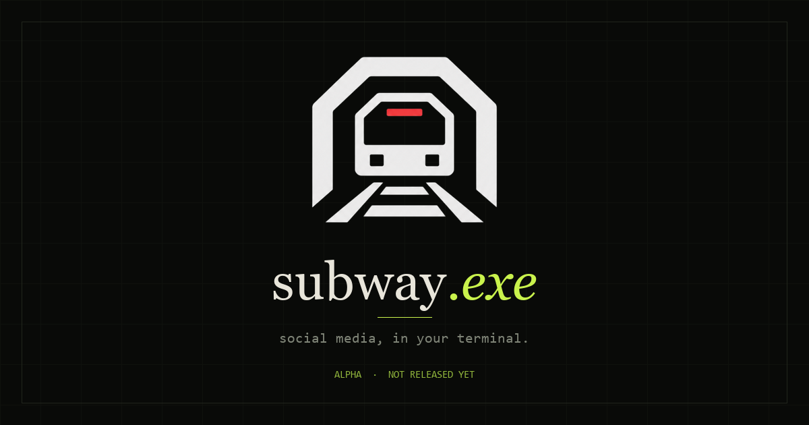

<p align="center">
  
</p>

<h1 align="center">subway.exe</h1>

<p align="center"><strong>Social media, in your terminal.</strong></p>

<p align="center">
  
  
</p>

subway.exe is a real social network that lives in the terminal. You install the CLI once, sign in, and posts, follows, and messages stay on the server — the same account from any machine.

> [!NOTE]
> This repository contains the marketing website only. The CLI and server are developed separately and are not public yet.

## Installation

The product is not released. There is no public npm package and no public server to connect to.

The planned install, once it ships, is:

```bash
npm install -g subwayexe
```

This command does not work today. The site marks the install and release status as incomplete instead of advertising something you cannot use.

## The product

**MVP**

- **Account:** register, login, logout, and `whoami`.
- **Posts:** text posts, a live chronological feed, likes, and comments.
- **Social:** follow/unfollow and profiles.
- **Chat:** realtime 1:1 conversations.

**Phase 2:** profile editing and password changes, public/private accounts with a global feed, an interactive menu, edit/delete, reposts, and 24-hour stories.

**Later:** photo posts converted to ASCII art.

## The site

- A terminal-native interface: monospace type, flat surfaces, hard rules, TUI frames, and the real logo.
- An interactive demo for `feed`, `profile`, and `chat`, with typed commands.
- A searchable reference for all 19 known commands, tagged `mvp` or `next`.
- An honest roadmap: MVP scope, missing release work, and the phase 2 sequence.
- The planned install command, clearly marked **not released**.
- Canonical metadata, Open Graph and Twitter cards, structured data, a sitemap, and robots rules.
- FAQ, responsive layout, light/dark favicons, a social preview, and reduced-motion support.

## Development

Requires Node.js and npm.

```bash
npm install
npm run dev      # http://localhost:5173
```

To check the production build:

```bash
npm run build    # static output in dist/
npm run preview
```

`dist/` is a static site and can be served by any static host. Set `VITE_SITE_URL` to the deployed origin before building so canonical URLs, absolute social images, `sitemap.xml`, and the sitemap entry in `robots.txt` use the real domain. Without it, those URL-dependent tags are skipped rather than pointing at a placeholder.

### GitHub Pages

The workflow in `.github/workflows/deploy.yml` builds with `VITE_BASE_PATH=/subway.exe/` and `VITE_SITE_URL=https://pittkajull.github.io/subway.exe`, then publishes `dist/` on every push to `main`.

In the repository, set **Settings → Pages → Build and deployment → Source** to **GitHub Actions** once. The site is served at `https://pittkajull.github.io/subway.exe/`.

If you move to a custom domain at the root, remove `VITE_BASE_PATH` from the workflow and set `VITE_SITE_URL` to that domain.

All public copy, command data, and roadmap content live in `src/data/content.js`. Keep install and status marked unreleased until the npm package actually ships.

## Contributing

Issues and pull requests about the marketing site are welcome. The CLI and server are not public yet, so this repository is the only part of the project you can contribute to right now.

Keep public copy within confirmed product facts: behavior, MVP scope, roadmap, command names and flags, the install command, and release status. Authentication internals, API contracts, database details, hosting plans, and unresolved security decisions stay out.

## Security

This repository is static and stores no user data. Do not commit API keys, tokens, passwords, or credential files. Report security issues privately through GitHub Security Advisories rather than a public issue.

## License

Released under the [MIT License](./LICENSE) — Copyright (c) 2026 Muhajir Amrullah.

This license covers the website source in this repository. The CLI and server may use a different license.
